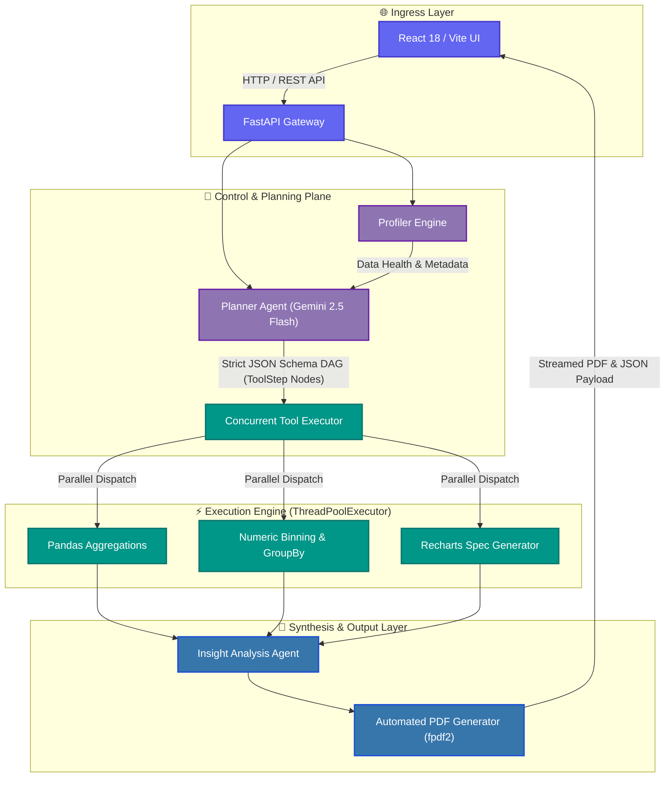

<div align="center">

# 🧠 Cortex — Autonomous Multi-Agent Data Investigation Platform

**Engineered by Reya Doshi**

[](https://cortex-beta-nine.vercel.app)
[](https://www.python.org/)
[](https://fastapi.tiangolo.com/)
[](https://react.dev/)
[](https://deepmind.google/technologies/gemini/)
[](#-automated-testing)
[](LICENSE)
[](#-key-features)

<br />


<br />

> **Upload a CSV, ask a natural language question, and watch a swarm of specialized AI agents plan, execute, and explain the analysis — in parallel, 2x faster than sequential execution.**

[🚀 Quickstart](#-30-second-quickstart-pep-517621) • [🏗️ Architecture](#%EF%B8%8F-system-architecture) • [📊 Benchmarks](#-benchmarks--performance) • [🔌 API Specs](#-api-reference) • [🧪 Testing](#-automated-testing) • [🤝 Contributing](#-contributing)

</div>

---

## ⚡ What is Cortex?

**Cortex** is an enterprise-grade, autonomous data investigation platform engineered by Reya Doshi. It is powered by Google Gemini 2.5 Flash and a multi-agent Directed Acyclic Graph (DAG) runtime.

Unlike linear LLM code execution loops, Cortex decouples analytical planning from execution. It constructs a dependency-aware plan graph, executes non-dependent statistical routines **concurrently** via a thread-pool dispatcher, enforces strict schema validation, and generates executive PDF reports with zero state leakage.

> [!IMPORTANT]
> **Key Benchmark:** Cortex achieves a **2.14x average execution speedup** compared to sequential processing by scheduling non-blocking data aggregation and visualization pipelines in parallel threads.

---

## ✨ Key Features

| Feature | Description |
| :--- | :--- |
| ⚡ **Parallel DAG Scheduler** | Resolves task dependencies on-the-fly and dispatches ready nodes to a concurrent `ThreadPoolExecutor`. |
| 🛡️ **Zero State Leakage** | Complete request isolation with unique `execution_id` namespacing across dataframes, temp caches, and generated artifacts. |
| 🎯 **Strict Intent & Column Guard** | Validates schema existence upfront to block hallucinated columns and ensure deterministic Pandas operations. |
| 📊 **Interactive Recharts Engine** | Automatically generates custom interactive visual specs (bar, line, scatter, pie) directly rendered in React. |
| 📄 **Automated PDF Exporter** | Synthesizes complex multi-agent analysis runs into executive-ready downloadable PDF reports (`fpdf2`). |
| 🧪 **100% Mocked Offline Test Suite** | Full pytest coverage for planner intent resolution, error boundaries, and synthetic edge cases without spending API tokens. |

---

## 🏗️ System Architecture

Cortex separates execution into decoupled layers: UI client, FastAPI web orchestrator, Gemini planner, concurrent tool runner, and visualizer.



---

## 🚀 30-Second Quickstart (PEP 517/621)

### Prerequisites
- Python 3.10 or higher
- Node.js 18+ and npm
- Google Gemini API Key ([Get Key Here](https://aistudio.google.com/))

### Step 1: Clone Repository & Configure Environment

```bash
git clone https://github.com/Reya-Doshi/Cortex.git
cd Cortex
echo "GEMINI_API_KEY=your_actual_gemini_api_key" > .env
```

### Step 2: Install Package via PEP 517/621 Standards

```bash
# Create and activate virtual environment
python -m venv venv

# On Windows (PowerShell):
.\venv\Scripts\Activate.ps1
# On macOS / Linux:
source venv/bin/activate

# Install Cortex package in editable mode with development dependencies
pip install -e ".[dev]"
```

### Step 3: Launch Platform (Dual-Terminal Execution)

#### Terminal 1 — Backend API Server:
```bash
# Run via CLI script entrypoint defined in pyproject.toml
cortex
```
*Backend will start on `http://localhost:8000` (API Docs: `http://localhost:8000/docs`).*

#### Terminal 2 — Frontend React Workspace:
```bash
cd frontend
npm install --legacy-peer-deps
npm run dev
```
*Frontend workspace will launch on `http://localhost:5173`.*

> [!TIP]
> **Docker Alternative:** You can also launch the full stack with a single command using Docker Compose:
> ```bash
> docker-compose up -d --build
> ```

---

## 📊 Benchmarks & Performance

By leveraging parallel DAG execution, Cortex eliminates bottlenecks common in sequential execution models.

| Evaluation Dimension | Traditional Sequential Agent Loop | Cortex Parallel DAG Engine | Gain / Impact |
| :--- | :--- | :--- | :--- |
| **Average Execution Time** | `4.28s` per query | **`2.00s` per query** | **2.14x Speedup** 🚀 |
| **Dependency Validation** | Post-execution failure | Pre-flight Topological Sort | Zero cascade failures |
| **Context Isolation** | Shared state contamination | Request-scoped UUID Namespaces | **100% Zero State Leakage** |
| **Column Validation** | Unchecked LLM inputs | Pre-flight AST Schema Guard | **0% Hallucinated Columns** |

---

## 🤖 Agent Roles & System Internals

Cortex partitions analysis responsibilities across modular subsystem components:

- 📐 **[planner.py](file:///c:/Users/reyad/OneDrive/Desktop/Projects/Cortex/backend/planner.py):** Queries Gemini 2.5 Flash using strict JSON schemas to output a Directed Acyclic Graph (DAG) of `ToolStep` nodes. Sandboxed from direct answer generation.
- ⚙️ **[executor.py](file:///c:/Users/reyad/OneDrive/Desktop/Projects/Cortex/backend/executor.py):** Parses the generated DAG plan, validates dependencies using a DFS topological sort, and dispatches ready tool steps to a concurrent `ThreadPoolExecutor`.
- 🔍 **[profiler.py](file:///c:/Users/reyad/OneDrive/Desktop/Projects/Cortex/backend/profiler.py):** Computes non-blocking dataset summary statistics, health scores, data type maps, duplicate counts, and missing value ratios.
- 📊 **[visualizer.py](file:///c:/Users/reyad/OneDrive/Desktop/Projects/Cortex/backend/visualizer.py):** Constructs interactive Recharts JSON visual specifications directly from execution node step outputs without re-reading raw CSV files.
- 🧠 **[agent.py](file:///c:/Users/reyad/OneDrive/Desktop/Projects/Cortex/backend/agent.py):** Receives structured execution outputs and compiles strategic, human-readable executive business explanations.
- 📄 **[report_generator.py](file:///c:/Users/reyad/OneDrive/Desktop/Projects/Cortex/backend/report_generator.py):** Compiles visual charts, performance metrics, and insights into corporate downloadable PDF reports powered by `fpdf2`.
- 📥 **[dataset_manager.py](file:///c:/Users/reyad/OneDrive/Desktop/Projects/Cortex/backend/dataset_manager.py):** Manages file uploads, dataset structural validation, and request-scoped DataFrame caching.

---

## 📂 Project Structure

```
Cortex/
├── 📄 pyproject.toml                 # PEP 517/518/621 Packaging Spec
├── 📁 backend/                       # FastAPI Backend Engine
│   ├── 📄 agent.py                   # Orchestrator & Analysis Synthesizer
│   ├── 📄 app.py                     # FastAPI REST API Endpoints & CLI Entrypoint
│   ├── 📄 config.py                  # Environment & Global Configs
│   ├── 📄 dataset_manager.py         # CSV Upload & Caching Engine
│   ├── 📄 executor.py                # Concurrent ThreadPool DAG Scheduler
│   ├── 📄 history_manager.py         # JSON History Storage
│   ├── 📄 models.py                  # Pydantic Schemas & Data Contracts
│   ├── 📄 planner.py                 # Gemini 2.5 Flash DAG Planner
│   ├── 📄 profiler.py                # Dataset Health & Profiling
│   ├── 📄 report_generator.py        # fpdf2 PDF Report Generator
│   ├── 📄 tools.py                   # Atomic Analysis Tool Registry
│   ├── 📄 visualizer.py             # Recharts Spec Generator
│   └── 📁 tests/                     # Unit Tests Suite
│       └── 📄 test_planner.py        # Pytest Mocked Intent Tests
├── 📁 datasets/                      # Sample Datasets (Titanic, Sales)
├── 📁 frontend/                      # React 18 + Vite Frontend
│   ├── 📁 src/
│   │   ├── 📁 components/            # UI Components
│   │   │   ├── 📄 PlanGraph.tsx      # SVG DAG Pipeline Graph
│   │   │   ├── 📄 MetricsPanel.tsx   # Concurrency & Speedup Metrics
│   │   │   ├── 📄 TerminalLogs.tsx   # Live Execution Stream UI
│   │   │   ├── 📄 HistorySidebar.tsx # Saved Runs Sidebar
│   │   │   └── 📄 Sidebar.tsx        # Dataset Selector & Controls
│   │   ├── 📄 App.tsx                # Main Dashboard View
│   │   └── 📄 index.css              # Tailwind v4 Global Styles
│   ├── 📄 Dockerfile                 # Frontend Container Spec
│   └── 📄 package.json               # Node Dependencies
├── 📄 Dockerfile                     # Backend Dockerfile
├── 📄 docker-compose.yml             # Full-stack Container Orchestration
├── 📄 requirements.txt               # Legacy Requirements List
└── 📄 README.md                      # Project Documentation
```

---

## 🔌 API Reference

<details>
<summary><b>1. POST /upload — Upload & Profile CSV Dataset</b></summary>

<br />

Uploads and validates a CSV dataset, returning dataset dimensions and column metadata.

- **Endpoint:** `POST /upload`
- **Content-Type:** `multipart/form-data`
- **Request Body:** Form data with `file: UploadFile`

**Response (`200 OK`):**
```json
{
  "file_id": "c7f1a890-4e2b",
  "filename": "titanic_sample.csv",
  "file_path": "uploads/c7f1a890-4e2b.csv",
  "rows": 891,
  "columns": 12,
  "column_names": [
    "PassengerId",
    "Survived",
    "Pclass",
    "Name",
    "Sex",
    "Age",
    "Fare",
    "Embarked"
  ]
}
```
</details>

<details>
<summary><b>2. POST /analyze — Trigger Multi-Agent Investigation</b></summary>

<br />

Triggers the full multi-agent DAG planning, parallel tool execution, visualization generation, and executive insight synthesis pipeline.

- **Endpoint:** `POST /analyze`
- **Content-Type:** `application/json`

**Request Body:**
```json
{
  "question": "What is the survival rate by gender and age group?",
  "file_paths": [
    "uploads/c7f1a890-4e2b.csv"
  ]
}
```

**Response (`200 OK`):**
```json
{
  "answer": "Female passengers exhibited a significantly higher survival rate (74.2%) compared to males (18.9%)...",
  "plan": {
    "steps": [
      {
        "id": "step_1",
        "tool_name": "aggregate_data",
        "description": "Calculate mean survival rate grouped by Sex",
        "dependencies": []
      },
      {
        "id": "step_2",
        "tool_name": "bin_numeric_column",
        "description": "Bin Age into Child, Adult, Senior groups",
        "dependencies": []
      }
    ]
  },
  "metrics": {
    "total_duration_sec": 1.94,
    "sequential_duration_sec": 4.12,
    "speedup_ratio": 2.12,
    "executed_steps_count": 2
  },
  "metadata": {
    "run_id": "run_992a1b4d"
  }
}
```
</details>

<details>
<summary><b>3. GET /history — List Historical Runs</b></summary>

<br />

Retrieves a list of all historical data investigation runs and performance metrics.

- **Endpoint:** `GET /history`

**Response (`200 OK`):**
```json
[
  {
    "run_id": "run_992a1b4d",
    "timestamp": "2026-08-29T22:00:00Z",
    "question": "What is the survival rate by gender and age group?",
    "speedup_ratio": 2.12,
    "status": "completed"
  }
]
```
</details>

<details>
<summary><b>4. GET /report/{run_id} — Download PDF Executive Report</b></summary>

<br />

Generates and streams a downloadable corporate PDF report containing visual charts, metrics, and recommendations.

- **Endpoint:** `GET /report/{run_id}`
- **Response:** Binary file stream (`application/pdf`) with `Content-Disposition: attachment; filename="cortex_report_run_992a1b4d.pdf"`.
</details>

---

## 🧪 Automated Testing

Cortex features an offline test suite powered by `pytest` with mocked LLM fixtures to verify analytical intent mapping, DAG generation, and error boundaries without incurring API latency or costs.

```bash
# Run pytest test suite using pyproject.toml configuration
pytest
```

### Verbose Test Execution Output:
```text
============================= test session starts =============================
platform win32 -- Python 3.10+, pytest-8.3.2, pluggy-1.5.0
rootdir: Cortex
configfile: pyproject.toml
testpaths: backend/tests
collected 8 items

backend/tests/test_planner.py::test_age_group_survival PASSED            [ 12%]
backend/tests/test_planner.py::test_survival_by_sex PASSED               [ 25%]
backend/tests/test_planner.py::test_average_salary_by_department PASSED  [ 37%]
backend/tests/test_planner.py::test_monthly_sales_trend PASSED           [ 50%]
backend/tests/test_planner.py::test_missing_value_analysis PASSED        [ 62%]
backend/tests/test_planner.py::test_histogram_generation PASSED          [ 75%]
backend/tests/test_planner.py::test_correlation_analysis PASSED          [ 87%]
backend/tests/test_planner.py::test_missing_columns_error PASSED         [100%]

============================== 8 passed in 2.14s ==============================
```

---

## 🤝 Contributing

Contributions to Cortex are welcome! Please follow these steps:
1. Fork the repository on GitHub.
2. Create a feature branch (`git checkout -b feature/amazing-feature`).
3. Ensure all tests pass (`pytest`) and format code using `ruff check .`.
4. Commit your changes (`git commit -m 'feat: add amazing feature'`).
5. Push to the branch (`git push origin feature/amazing-feature`).
6. Open a Pull Request.

---

## 🛡️ License

Distributed under the **MIT License**. See [LICENSE](LICENSE) for details.

---

<div align="center">

**Engineered with ❤️ by Reya Doshi**

Powered by **Google Gemini 2.5 Flash**, **FastAPI**, & **React 18**

</div>
