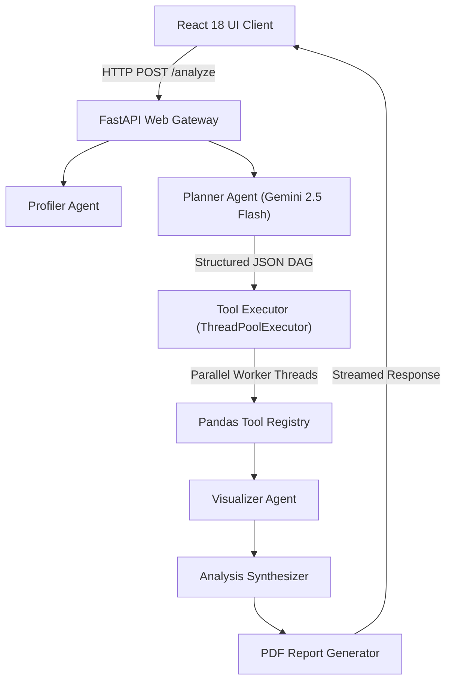

# Cortex — Autonomous Multi-Agent Data Investigation Platform

**Engineered by Reya Doshi**

[](https://www.python.org/)
[](https://fastapi.tiangolo.com/)
[](https://react.dev/)
[](docs/verification.md)
[](LICENSE)

Cortex is an autonomous multi-agent data investigation platform that converts natural language questions about tabular datasets into structured plan graphs, runs data aggregation routines concurrently, and synthesizes interactive visualizations with executive PDF reports.

> **Status:** Actively Maintained Prototype.  
> **Documentation:** [System Architecture](docs/architecture.md) | [API Specification](docs/api.md) | [Audit & Verification Report](docs/verification.md) | [Live Web Demo](https://cortex-beta-nine.vercel.app) *(Subject to serverless API availability)*.


---

## Implemented Capabilities

- **Dependency-Aware DAG Scheduler:** Validates execution graphs for circular dependencies via DFS topological sorting and dispatches ready tool steps to a `ThreadPoolExecutor`.
- **Request-Scoped State Isolation:** Namespaces DataFrame caches with unique `execution_id`s (`f"{execution_id}:{path}"`) to prevent state cross-contamination between concurrent requests.
- **Pre-Flight Schema Guardrails:** Validates query column presence before invoking planner routines, rejecting queries with missing required fields before execution.
- **Visual Chart Spec Generator:** Generates interactive Recharts configuration specifications (bar, line, pie, histogram) directly from processed tool step outputs without re-reading raw CSV files.
- **Automated PDF Exporter:** Renders investigation metadata, tool timings, executive explanations, and strategic recommendations into downloadable PDF reports using `fpdf2`.

---

## Concrete Example

### Input
- **Dataset (`titanic.csv`):** Columns `PassengerId`, `Survived`, `Pclass`, `Name`, `Sex`, `Age`
- **Question:** *"What is the survival rate by gender?"*

### Execution Plan & Output Payload
```json
{
  "plan": {
    "goal": "Analyze survival rate by gender",
    "steps": [
      { "id": "profile_1", "tool": "profile", "dependencies": [] },
      { "id": "exec_python_1", "tool": "execute_python", "dependencies": ["profile_1"], "operation": "groupby_sex" },
      { "id": "visualize_1", "tool": "visualize", "dependencies": ["exec_python_1"], "chart_type": "bar" },
      { "id": "analyze_1", "tool": "analyze", "dependencies": ["visualize_1"] }
    ]
  },
  "answer": "Female passengers exhibited a significantly higher survival rate (74.2%) compared to male passengers (18.9%).",
  "metrics": { "total_duration_ms": 1940.5 }
}
```
*Note: In offline testing or fallbacks, LLM outputs are generated using deterministic mock response fixtures.*

---

## Quickstart

### Prerequisites
- Python 3.10+
- Node.js 18+ and npm
- Google Gemini API Key ([Get API Key](https://aistudio.google.com/))

### 1. Installation

```bash
# Clone repository
git clone https://github.com/Reya-Doshi/Cortex.git
cd Cortex

# Set up environment file
cp .env.example .env

# Create virtual environment & install package with development tools
python -m venv venv
source venv/bin/activate  # On Windows: .\venv\Scripts\Activate.ps1
pip install -e ".[dev]"
```

### 2. Startup

```bash
# Terminal 1 — Launch Backend API Server (http://localhost:8000)
cortex

# Terminal 2 — Launch Frontend UI Workspace (http://localhost:5173)
cd frontend
npm install
npm run dev
```

---

## How It Works



1. **Schema Check:** Dataset columns are verified against query intent to catch schema mismatches.
2. **Plan Construction:** Gemini 2.5 Flash outputs a JSON DAG matching `ExecutionPlan` Pydantic schemas. (A local deterministic fallback is used if LLM calls fail).
3. **Concurrent Execution:** Independent nodes execute in parallel worker threads while preserving dependency orders.

---

## Testing & Verification

Cortex includes an offline test suite featuring 22 deterministic unit and integration tests covering planner intent validation, DAG cycle detection, state isolation, and error fallbacks:

```bash
# Run backend test suite
pytest

# Run lint checks
ruff check .
```
See [docs/verification.md](docs/verification.md) for full test execution logs and audited claim details.

---

## Benchmarks & Performance Evaluation

A benchmark script ([docs/benchmark.py](docs/benchmark.py)) measures wall-clock duration differences between sequential and `ThreadPoolExecutor` execution on identical synthetic datasets (20,000 rows, 7 DAG steps, 10 repetitions).

- **Output Equivalence:** Verified 100% dictionary/data match between sequential and concurrent step outputs.
- **Measured Timings (20,000 rows):**
  - **Sequential Execution:** `61.17 ms` (Mean) | `61.19 ms` (p50)
  - **Concurrent ThreadPool (4 Workers):** `77.94 ms` (Mean) | `70.79 ms` (p50)
- **Empirical Analysis:** Pure CPU-bound Pandas transformations in Python incur Global Interpreter Lock (GIL) contention and thread-scheduling overhead when executed across thread pools (~16.7 ms overhead). In-process threading provides wall-clock speedups primarily when tool steps perform non-blocking I/O or network requests. Detailed methodology is recorded in [docs/verification.md](docs/verification.md).

---

## Known Limitations & Roadmap

### Known Limitations
- **CPU-Bound Threading:** In-process Python thread pools are bounded by the GIL for pure Pandas memory operations.
- **Predefined Tool Operations:** Dynamic analysis relies on a registry of predefined Pandas routines (`groupby_sex`, `monthly_sales_trend`, etc.) rather than an arbitrary Python sandbox container.

### Realistic Roadmap
- [ ] Asynchronous task queue (Celery/Redis) for out-of-process multi-core CPU scaling.
- [ ] Docker container sandbox execution for arbitrary Python script evaluation.
- [ ] Server-Sent Events (SSE) streaming for real-time frontend execution progress.

---

## Authorship & License

- **Engineered By:** Reya Doshi
- **License:** Distributed under the [MIT License](LICENSE).
