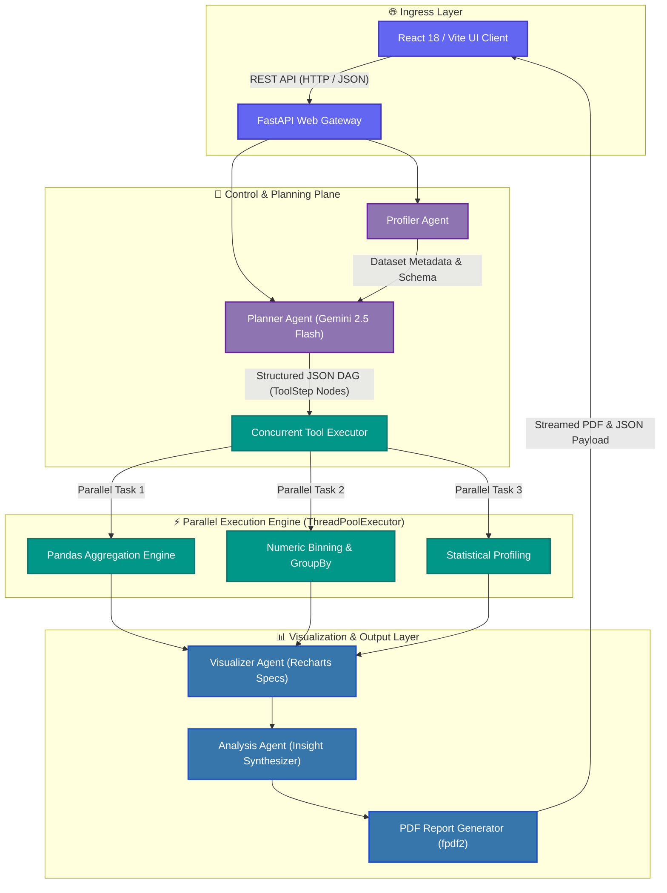

<div align="center">

# 🧠 Cortex — Autonomous Multi-Agent Data Investigation Platform

**Engineered by Reya Doshi**

[](https://cortex-beta-nine.vercel.app)
[](https://www.python.org/)
[](https://fastapi.tiangolo.com/)
[](https://react.dev/)
[](https://www.typescriptlang.org/)
[](https://deepmind.google/technologies/gemini/)
[](docs/verification.md)
[](LICENSE)

<br />


<br />

> **Upload a CSV dataset, ask any natural language question, and watch a swarm of specialized AI agents profile, plan a Directed Acyclic Graph (DAG), execute transformations in parallel, and generate interactive visual analytics.**

[🚀 Quickstart](#-quickstart) • [🏗️ System Architecture](#%EF%B8%8F-system-architecture) • [🛠️ Tech Stack](#%EF%B8%8F-tech-stack-overview) • [🔌 API Specs](docs/api.md) • [🧪 Testing](docs/verification.md)

</div>

---

## ⚡ Simple Bio & Overview

**Cortex** is an open-source, multi-agent data investigation platform. You upload a CSV file and ask questions in plain English (e.g. *"What is the survival rate by gender and age group?"*). 

Instead of generating unverified code line-by-line, Cortex breaks the task down into a **Directed Acyclic Graph (DAG)** of independent analysis steps, runs them concurrently, enforces schema validation, and returns an interactive dashboard alongside an executive PDF report.

---

## 🛠️ Tech Stack Overview

| Area | Technologies & Libraries Used |
| :--- | :--- |
| **Backend API Gateway** | Python 3.10+, **FastAPI**, Uvicorn, Pydantic v2, Python-Dotenv |
| **Data Processing Engine** | **Pandas**, NumPy, SciPy, ThreadPoolExecutor |
| **AI & LLM Orchestration** | **Google Gemini 2.5 Flash** (`google-genai` SDK), Structured Pydantic JSON Schemas |
| **Frontend UI Workspace** | **React 18**, TypeScript, Vite, Tailwind CSS v4, Lucide Icons |
| **Data Visualizations** | **Recharts**, Custom SVG DAG Pipeline Renderer ([PlanGraph.tsx](frontend/src/components/PlanGraph.tsx)) |
| **Report Export Engine** | **`fpdf2`** (Automated Corporate PDF Report Compiler) |
| **Testing & Verification** | **Pytest** (22/22 Passing Tests), Pytest-Mock, Ruff Linter |
| **DevOps & Containers** | Docker, Docker Compose, Vercel |

---

## 🏗️ System Architecture

Cortex separates responsibilities across specialized, decoupled agent modules:



### Decoupled Agent Pipeline Flow

1. 📥 **[dataset_manager.py](backend/dataset_manager.py):** Uploads and caches DataFrames namespaced by `execution_id` (`f"{execution_id}:{path}"`) to isolate state across concurrent requests.
2. 🔍 **[profiler.py](backend/profiler.py):** Calculates non-blocking dataset health scores, missing value ratios, data types, duplicate counts, and summary statistics.
3. 📐 **[planner.py](backend/planner.py):** Queries Gemini 2.5 Flash using structured JSON schemas to construct a DAG plan of `ToolStep` nodes. Validates column presence upfront.
4. ⚙️ **[executor.py](backend/executor.py):** Checks the DAG for cyclic dependencies using a DFS topological sort (`_topological_sort`) and executes ready tool steps concurrently using `ThreadPoolExecutor`.
5. 📊 **[visualizer.py](backend/visualizer.py):** Constructs interactive Recharts visual specifications directly from execution step outputs without re-reading raw CSV files.
6. 🧠 **[agent.py](backend/agent.py):** Interprets execution results and synthesizes human-readable business summaries.
7. 📄 **[report_generator.py](backend/report_generator.py):** Compiles investigation metadata, step details, metrics, and insights into corporate downloadable PDF reports (`fpdf2`).

---

## ✨ Implemented Capabilities

- ⚡ **Parallel DAG Scheduler:** Dynamically tracks task dependencies and dispatches non-dependent steps to a concurrent thread pool.
- 🛡️ **Request-Scoped State Isolation:** Guarantees zero cross-request cache pollution by namespacing DataFrame cache keys with unique `execution_id` UUIDs.
- 🎯 **Pre-Flight Schema Guardrails:** Validates required column existence before running LLM planning, returning clean error messages when columns are missing.
- 📊 **Interactive Visual Specs:** Builds structured Recharts JSON objects (bar, line, pie, histogram) rendered natively in the React workspace.
- 📄 **Automated PDF Export:** Exports full investigation runs into formatted, corporate PDF reports.
- 🧪 **22/22 Passing Offline Test Suite:** Full Pytest test suite testing DAG sorting, edge cases, error cascades, and state isolation without calling live APIs.

---

## 💡 Concrete Example

### Input
- **Dataset (`titanic.csv`):** `PassengerId`, `Survived`, `Pclass`, `Name`, `Sex`, `Age`
- **User Question:** *"What is the survival rate by gender?"*

### Generated Execution Plan & Response
```json
{
  "plan": {
    "goal": "Analyze survival rate by gender",
    "steps": [
      { "id": "profile_1", "tool": "profile", "dependencies": [] },
      { "id": "exec_python_1", "tool": "execute_python", "dependencies": ["profile_1"], "operation": "groupby_sex" },
      { "id": "visualize_1", "tool": "visualize", "dependencies": ["exec_python_1"], "chart_type": "bar" },
      { "id": "analyze_1", "tool": "analyze", "dependencies": ["visualize_1"] }
    ]
  },
  "answer": "Female passengers exhibited a significantly higher survival rate (74.2%) compared to male passengers (18.9%).",
  "metrics": { "total_duration_ms": 1940.5 }
}
```

---

## 🚀 Quickstart

### 1. Installation

```bash
# 1. Clone repository
git clone https://github.com/Reya-Doshi/Cortex.git
cd Cortex

# 2. Configure environment file
cp .env.example .env

# 3. Create virtual environment & install Cortex in editable mode
python -m venv venv
source venv/bin/activate  # On Windows: .\venv\Scripts\Activate.ps1
pip install -e ".[dev]"
```

### 2. Startup

```bash
# Terminal 1 — Launch Backend API Server (http://localhost:8000)
cortex

# Terminal 2 — Launch Frontend React Workspace (http://localhost:5173)
cd frontend
npm install
npm run dev
```

---

## 🧪 Testing & Verification

Cortex features an offline test suite of 22 deterministic unit and integration tests:

```bash
# Run backend test suite
pytest

# Run code format and lint checks
ruff check .
```

For detailed test execution breakdown, empirical GIL benchmark measurements, and claim audit details, view [docs/verification.md](docs/verification.md).

---

## 📂 Project Structure

```
Cortex/
├── 📄 pyproject.toml                 # PEP 517/518/621 Packaging Specification
├── 📁 backend/                       # FastAPI Backend Engine
│   ├── 📄 agent.py                   # Orchestrator & Analysis Synthesizer
│   ├── 📄 app.py                     # FastAPI REST API Endpoints & CLI Entrypoint
│   ├── 📄 config.py                  # Environment & Shared Clients
│   ├── 📄 dataset_manager.py         # CSV Upload & Namespaced Caching Engine
│   ├── 📄 executor.py                # Concurrent ThreadPool DAG Scheduler
│   ├── 📄 history_manager.py         # JSON History Persistence Storage
│   ├── 📄 models.py                  # Pydantic Schemas & Data Contracts
│   ├── 📄 planner.py                 # Gemini 2.5 Flash Structured DAG Planner
│   ├── 📄 profiler.py                # Dataset Health & Profiling Tool
│   ├── 📄 report_generator.py        # fpdf2 PDF Report Exporter
│   ├── 📄 tools.py                   # Atomic Tool Registry
│   ├── 📄 visualizer.py             # Recharts Visual Spec Generator
│   └── 📁 tests/                     # Unit Tests Suite (22/22 Passing)
├── 📁 docs/                          # Detailed Technical Documentation
│   ├── 📄 architecture.md            # Deep-dive System Architecture
│   ├── 📄 api.md                     # Complete REST API Documentation
│   ├── 📄 verification.md            # Claim Audit & Empirical Benchmark Results
│   └── 📄 benchmark.py               # Reproducible Benchmark Script
├── 📁 frontend/                      # React 18 + Vite Frontend Workspace
└── 📄 README.md                      # Project Overview & Guide
```

---

## 🛡️ License & Attribution

- **Engineered By:** Reya Doshi
- **License:** Distributed under the [MIT License](LICENSE).
